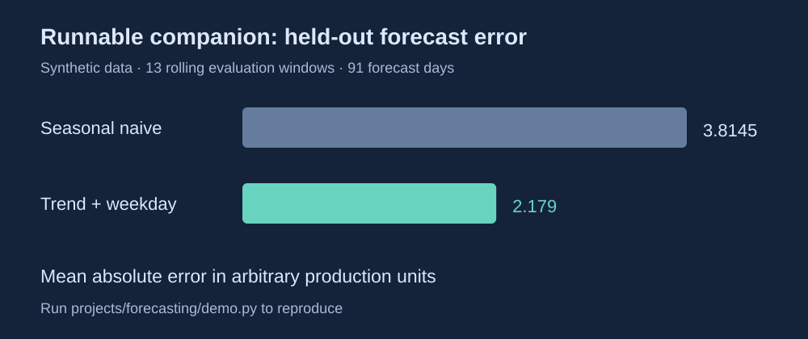

### Rolling-origin forecast evaluation

The public companion in [my Resume repository](https://github.com/placenciohid/Resume/tree/main/projects/forecasting) implements a complete, reproducible rolling-origin evaluation. It uses synthetic daily production, so a visitor can inspect the mechanics without needing Rio Tinto data. Its results below are separate from the professional projects described above.

#### Inputs and model

The sample has 180 daily observations in arbitrary units, with a linear trend, weekday effects, and seeded noise. A seasonal-naive baseline repeats last week's daily values. The comparison estimates a linear trend and weekday residuals. Neither is the internal Temporal Fusion Transformer model.

#### Evaluation design

Start with 84 training days. Fit each model, forecast seven days, advance the origin by seven days, and fit again. Thirteen windows produce 91 held-out daily predictions. Fitting and residual ranges use only history before each origin.

```python
def backtest(rows, initial=84, horizon=7):
    actual, seasonal, trend = [], [], []
    folds = []
    for origin in range(initial, len(rows)-horizon+1, horizon):
        history, future = rows[:origin], rows[origin:origin+horizon]
        model = fit(history)  # Every fold is fitted again, using past rows only.
        expected = predict(model, [r['date'] for r in future])
        actual.extend(r['value'] for r in future)
        seasonal.extend(r['value'] for r in history[-7:])
        trend.extend(r['forecast'] for r in expected)
        folds.append({'trained_through': history[-1]['date'], 'predict_from': future[0]['date'],
                      'predict_through': future[-1]['date']})
    return {'folds': folds, 'forecasted_days': len(actual),
            'seasonal_naive': metrics(actual, seasonal), 'trend_plus_weekday': metrics(actual, trend)}
```

##### Executed synthetic results



| Model | Mean absolute error | WAPE |
| --- | ---: | ---: |
| Repeat previous week | 3.8145 units | 2.14% |
| Trend + weekday | 2.179 units | 1.22% |

These numbers describe an intentionally simple generated series. The generator contains trend and weekday structure, so the improvement is expected; it is not a validation of performance on mining or receivables data. Residual percentile ranges are illustrative rather than calibrated coverage guarantees.

#### Reproduce and inspect

```bash
python projects/forecasting/demo.py
python -m unittest discover -s tests -v
```

[Full source](https://github.com/placenciohid/Resume/blob/main/projects/forecasting/demo.py) · [All evaluation origins and results](https://github.com/placenciohid/Resume/blob/main/projects/forecasting/results.json). Python 3.10+; no external dependencies. A production extension would address missing days, covariates, shutdowns, and performance at the planning horizon used by the business. A cash model also needs invoice-level availability dates and customer payment behavior.
