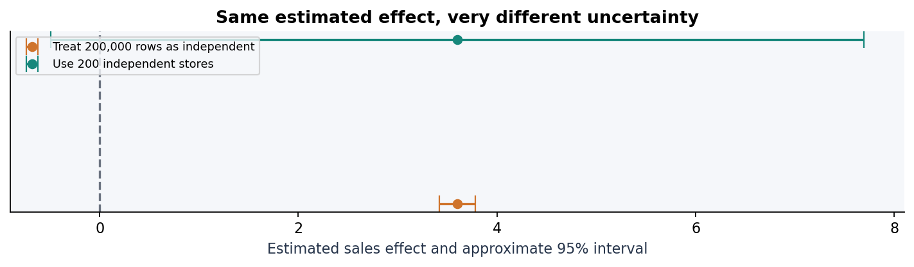

**More rows do not necessarily mean more independent evidence.**

This project examines two problems in interpreting an experiment: customers grouped within stores, and participants who do not follow their assigned treatment. “Clustering” here means grouped experimental observations—not K-means segmentation.

The original notebook uses a hypothetical store experiment and an encouragement exercise. The maintained companion audits the saved arithmetic and corrects an incremental treatment comparison. It makes the inference choices explicit without pretending that the original source dataset is available.

## Same effect, twenty-two times the standard error

The store exercise contains 200,000 customer observations across 200 stores. Treatment is assigned at the store level. Customers within a store share the same treatment and may also share store-level influences, so treating every customer as an independent experimental unit understates uncertainty.

The original output compares a row-level calculation with an analysis of store-level averages:

| Analysis | Estimated sales effect | Standard error | Approximate 95% interval |
| --- | ---: | ---: | --- |
| Treat customer rows as independent | 3.6004 | 0.0939 | [3.4163, 3.7845] |
| Treat stores as independent | 3.6004 | 2.0874 | [-0.4908, 7.6916] |



The point estimate is effectively unchanged, while the store-level standard error is about **22.22 times larger** and the interval crosses zero. The decision changes from apparently precise evidence of an increase to a much less certain result.

This exercise has equal-sized stores, making the row-weighted and store-weighted estimates coincide. With unequal sizes, the estimand and weighting need to be specified. The intervals above use the notebook's normal approximation; a complete analysis would also consider the randomization design and finite-cluster inference.

## Non-compliance: keep the numerator and denominator aligned

The second exercise gives these hypothetical outcome and uptake rates:

| Assignment | Outcome rate | Treatment uptake |
| --- | ---: | ---: |
| Control | 64% | 0% |
| Email | 66% | 40% |
| Email plus call | 68% | 60% |

The intention-to-treat effect compares assigned groups. A Wald ratio divides the outcome difference by the uptake difference. For email plus call versus email, the correct incremental comparison is:

```python
(0.68 - 0.66) / (0.60 - 0.40)  # 0.10
```

The original final comparison used the control group's outcome in the numerator while using the two treatment groups in the denominator, producing 0.20. The maintained [demo.py](https://github.com/placenciohid/Resume/blob/main/projects/clustering-noncompliance/demo.py) accepts both comparison groups explicitly and returns **0.10**, or ten percentage points under the exercise's assumptions.

Interpreting a Wald ratio causally requires assumptions such as a valid randomized encouragement, a nonzero first stage, exclusion, and monotonicity. The arithmetic alone does not establish those assumptions. In particular, a reminder call could affect the outcome through a channel other than the recorded treatment uptake.

## Why this belongs in an operations portfolio

A process pilot can look successful because of how the analysis counts observations or defines the comparison. Before scaling an intervention, I want to know which unit was assigned, whether outcomes are correlated within teams or sites, what the treatment actually changed, and whether the uncertainty supports the decision. The practical contribution is preventing a confident conclusion from resting on the wrong denominator.

## Reproduce and inspect

```bash
python projects/clustering-noncompliance/demo.py
python -m unittest discover -s tests -v
```

Python 3.10+, standard library only. [results.json](https://github.com/placenciohid/Resume/blob/main/projects/clustering-noncompliance/results.json) reconstructs the saved intervals and exercise contrasts. [The original notebook](https://github.com/placenciohid/Resume/blob/main/projects/clustering-noncompliance/legacy/Clustering%20and%20Non-Compliance.ipynb) retains the analysis trail. The underlying `cluster.csv` is not included; this companion verifies the reported arithmetic rather than regenerating the original sample.
