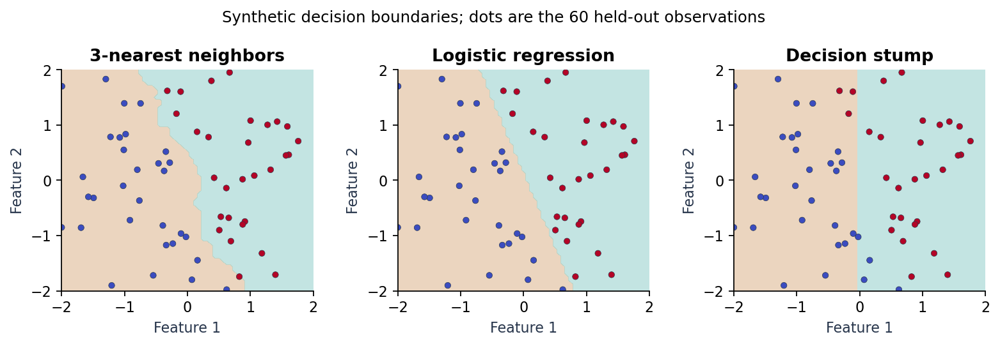

**Implement the learning rule, then explain where its assumptions help or hurt.**

This project implements nearest neighbors, logistic regression, and a decision tree from first principles. The original coursework notebook contains NumPy implementations, email classification experiments, and tree construction. The maintained Python companion makes a smaller comparison reproducible without external data or machine-learning packages.

## What is being compared?

The synthetic task labels points according to `x1 + 0.4*x2 > 0`. A fixed seed generates 240 observations: 180 for training and 60 held out. The same split is used for all three classifiers, and test observations do not enter fitting or threshold selection.

| Classifier | What it learns or retains | Main assumption |
| --- | --- | --- |
| 3-nearest neighbors | All training examples; predicts by local majority | Nearby points have similar labels |
| Logistic regression | An intercept and two gradient-trained coefficients | A linear score is sufficient for the boundary |
| Decision stump | One feature, threshold, and direction | A single axis-aligned split is useful |



## Results explain the model, not just the ranking

| Model | Correct held-out predictions | Accuracy |
| --- | ---: | ---: |
| 3-nearest neighbors | 59 / 60 | 98.33% |
| Logistic regression | 60 / 60 | 100.00% |
| Decision stump | 53 / 60 | 88.33% |

The true boundary is linear, so logistic regression has an appropriate form. Nearest neighbors follows local examples; its result depends on sample density. The stump can only split along one feature, so it cannot represent the tilted boundary exactly. The plot makes those differences easier to understand than the three scores alone.

These are controlled synthetic results on a small, noiseless problem. They establish observable implementation behavior, not expected performance on an operational dataset.

## Implementation choices that matter

The logistic-regression update averages gradients over the training rows, including the intercept. Its sigmoid clips large inputs to keep exponentiation finite. The objective is binary cross-entropy; using a probability model makes the classification threshold an explicit decision rather than part of the fitting algorithm.

```python
error = sigmoid(sum(a*b for a,b in zip(weights, features))) - y
gradient = [g + error*f for g,f in zip(gradient, features)]
weights = [w - rate*g/len(xs) for w,g in zip(weights, gradient)]
```

The nearest-neighbor implementation uses squared Euclidean distance, so it avoids a square root that cannot change the ranking. Its brute-force cost grows with the number of stored examples. The stump searches candidate thresholds and both label directions using training error; it is a depth-one tree, while the [original notebook](https://github.com/placenciohid/Resume/blob/main/projects/ml-from-scratch/legacy/Building%20Machine%20Learning%20Models%20from%20Scratch%20-%20Decision%20Trees%2C%20kNN%2C%20and%20Logistic%20Regression.ipynb) explores recursive splits with entropy, information gain, and gain ratio.

## How I would challenge the result

A useful follow-up would change the data rather than celebrate a perfect score: add label noise, rotate the boundary, vary the number of training rows, and change the scale of one feature. kNN is particularly sensitive to feature scale; a deeper tree changes the bias–variance tradeoff; regularization helps logistic regression when the problem is no longer so cleanly separated.

For an imbalanced operational task, I would add probability calibration, precision–recall measures, and performance at a chosen review capacity. The [event-prediction project](https://github.com/placenciohid/Resume/tree/main/projects/event-prediction) covers the separate problem of preparing those observations without temporal leakage.

## Reproduce

```bash
python projects/ml-from-scratch/demo.py
python -m unittest discover -s tests -v
```

Python 3.10+, standard library only. [demo.py](https://github.com/placenciohid/Resume/blob/main/projects/ml-from-scratch/demo.py) contains the full fitting and prediction logic; [results.json](https://github.com/placenciohid/Resume/blob/main/projects/ml-from-scratch/results.json) stores the output. Tests use a simple known boundary and extreme sigmoid inputs. The historical notebook requires its original coursework files; the companion provides an immediately runnable way to inspect the core algorithms.

[Website article](https://placenciohid.github.io/2023/07/12/MLScratch.html)
