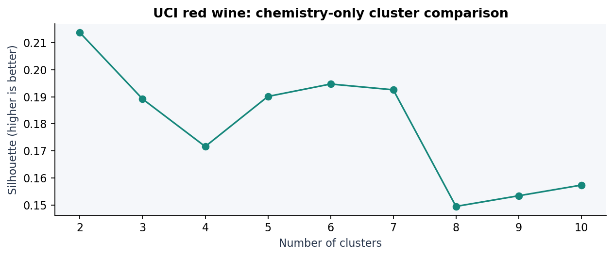

**Find groups in the chemistry, then ask whether those groups are distinct enough to be useful.**

This project revisits an original K-means and PCA notebook using the UCI red-wine dataset. The maintained analysis separates the eleven physicochemical measurements from the sensory quality score before clustering. That separation matters: including the outcome in the distance calculation would make a later comparison with quality partly circular.

## The analysis question

Can chemical measurements reveal repeatable groups of wines, and what does a two-dimensional visualization actually show? This is exploratory segmentation, rather than a model trained to predict a high-quality wine.

[analyze.py](https://github.com/placenciohid/Resume/blob/main/projects/wine-clustering/analyze.py) standardizes the eleven input measurements, fits K-means for `k=2..10`, compares silhouette, Davies–Bouldin, and Calinski–Harabasz scores, and checks the selected partition under three additional seeds. Quality is used only afterward to describe the resulting groups.

## Results: a useful caution about attractive clusters



The largest silhouette in this sweep is **0.2137 at k=2**. This favors two groups under the chosen metric, but the modest score indicates substantial overlap. Stable labels across seeds do not turn overlapping data into sharply separated categories.

The selected partition's adjusted Rand agreement with the additional seeds ranges from **0.9950 to 1.0000**. Stability answers whether repeated fitting produces similar assignments. Separation answers whether the assignments form distinct groups. These are different checks, and both belong in the interpretation.

| Cluster | Rows | Mean alcohol | Mean volatile acidity | Mean quality, described after fitting |
| --- | ---: | ---: | ---: | ---: |
| 0 | 590 | 10.6074 | 0.4139 | 5.8949 |
| 1 | 1009 | 10.3151 | 0.5944 | 5.4846 |

The quality difference is descriptive, not evidence that the cluster caused better quality. The observations do not include production interventions, costs, or commercial outcomes.

## Why scaling and PCA need explanation

Distance-based clustering is sensitive to units. Without scaling, a measurement with a large numerical range can dominate the grouping. Standardization gives each chemistry feature a comparable starting scale; it does not establish that all features have equal operational importance.

The first two principal components explain **45.68%** of variance. A two-axis plot therefore discards more than half of the standardized variation. Reaching 95% requires **nine components** in this run. A visually clean two-dimensional projection would not, by itself, justify a claim of clear separation in the original eleven-dimensional space.

## Relationship to the original notebook

The [historical notebook](https://github.com/placenciohid/Resume/blob/main/projects/wine-clustering/legacy/Unsupervised%20Learning%20-%20Wine%20Quality.ipynb) compared several cluster diagnostics, selected seven groups, and explored PCA. It standardized the full dataframe, including quality. The maintained analysis makes the chemistry-only question explicit, so its cluster count and diagnostics should not be read as a rerun of the same input space.

The source contains 1,599 rows, including 240 exact duplicate rows. They are retained in this exploratory analysis to preserve the published sample. Repeated rows can affect the weighting of the fitted centers; a deduplicated sensitivity analysis would be a sensible next comparison.

## Reproduce

```bash
python -m pip install -r requirements-analysis.txt
python projects/wine-clustering/analyze.py
```

[analysis-results.json](https://github.com/placenciohid/Resume/blob/main/projects/wine-clustering/analysis-results.json) records all candidate metrics, feature names, seed agreements, PCA variance, and group profiles. The [UCI data](https://github.com/placenciohid/Resume/blob/main/data/public/README.md) is included with attribution under CC BY 4.0. The practical lesson is to explain what makes a segment defensible before assigning business meaning to a colored scatterplot.

[Silhouette definition](https://scikit-learn.org/stable/modules/generated/sklearn.metrics.silhouette_score.html) · [Wine prediction comparison](https://github.com/placenciohid/Resume/tree/main/projects/wine-neural-networks)
