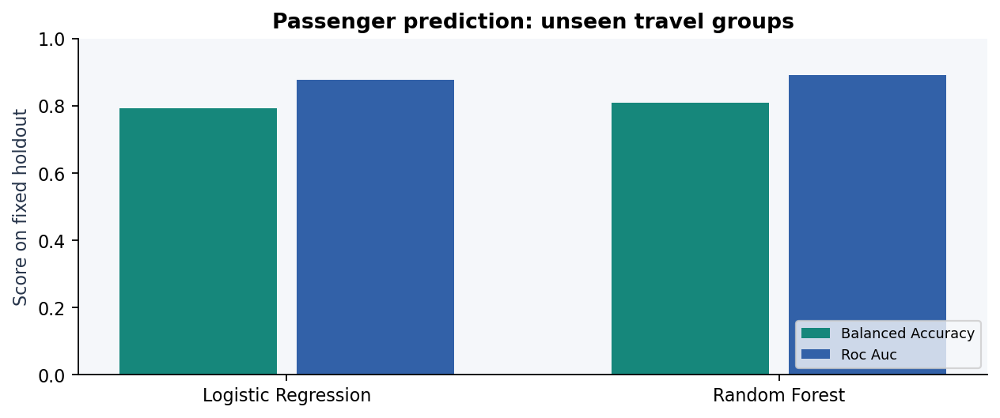

**A split should reflect who the model will be asked to predict, not just produce two random sets of rows.**

Spaceship Titanic is a Kaggle classification exercise with mixed numeric and categorical passenger records. My original notebooks compare several classifiers, feature engineering, tuning, and ensembles. The maintained analysis focuses on a specific evaluation question: how do two understandable baselines perform on passengers from travel groups absent from training?

## Why groups change the problem

Passenger IDs contain a travel-group prefix. People in a group can share contextual information. If related passengers appear in both training and validation, a model can benefit from group similarity even when the intended application concerns entirely new groups.

The new [analysis](https://github.com/placenciohid/Resume/blob/main/projects/spaceship-titanic/analyze.py) holds out 20% of distinct groups with a fixed seed. It uses cabin deck and side, origin, destination, age, spending, VIP, and cryosleep fields. Passenger IDs and names are excluded from the predictors.

## Keep preparation inside the pipeline

The numeric branch imputes training medians and standardizes values. The categorical branch imputes a training-set mode and one-hot encodes known categories, tolerating unseen categories at prediction. Both branches are fitted only on training rows.

Two fixed models share this preparation: logistic regression and a random forest with 150 trees, maximum depth ten, and at least three samples per leaf. The comparison does not search hyperparameters against the holdout or generate a new competition submission.



## Reproduced result

The split contains **6,930 training passengers and 1,763 held-out passengers**, with **zero group overlap**.

| Model | Accuracy | ROC AUC | Brier score (lower is better) |
| --- | --- | --- | --- |
| Logistic Regression | 79.35% | 0.8775 | 0.1419 |
| Random Forest | 80.83% | 0.8919 | 0.1360 |

The forest makes 338 classification errors on this holdout, versus 364 for logistic regression. Its ROC AUC and Brier score also improve, supporting a nonlinear model under this protocol. This is local validation, not a Kaggle leaderboard score.

## What the earlier experiments add

The [longer original notebook](https://github.com/placenciohid/Resume/blob/main/projects/spaceship-titanic/legacy/Spaceship%20Titanic%20-%20Kaggle%20Competition.ipynb) explores logistic regression, forests, boosting, neural networks, tuning, and voting. A [second notebook](https://github.com/placenciohid/Resume/blob/main/projects/spaceship-titanic/legacy/Spaceship%20Titanic%20-%20Kaggle.ipynb) evaluates additional boosting and stacking approaches. Their saved results remain useful evidence of experimentation, but use different preprocessing and split protocols.

The original tables also illustrate a common practical issue: model metrics can be copied or overwritten during notebook experimentation. The maintained script computes its summary from each fitted model in one pass, records a source-data hash, and writes a complete JSON result. That makes it easier to trace a claim back to an executable calculation.

## Next question: what is driving the errors?

I would inspect performance by cabin category, age band, missing-data pattern, and travel-group size before adding another ensemble. Repeating the grouped split would show whether the observed advantage depends strongly on which groups were held out. If the deployment question instead concerned an additional member of a known group, I would state that different objective and design the validation accordingly.

## Reproduce

```bash
python -m pip install -r requirements-analysis.txt
python projects/spaceship-titanic/analyze.py
```

The script reads the existing training CSV, leaves the unlabeled competition test data untouched, and prints [these metrics](https://github.com/placenciohid/Resume/blob/main/projects/spaceship-titanic/analysis-results.json). The [Kaggle competition](https://www.kaggle.com/competitions/spaceship-titanic) supplies the original task and data context. No claim is made about deploying a fictional passenger predictor; the transferable work is the data contract, evaluation design, and comparison of model complexity.
