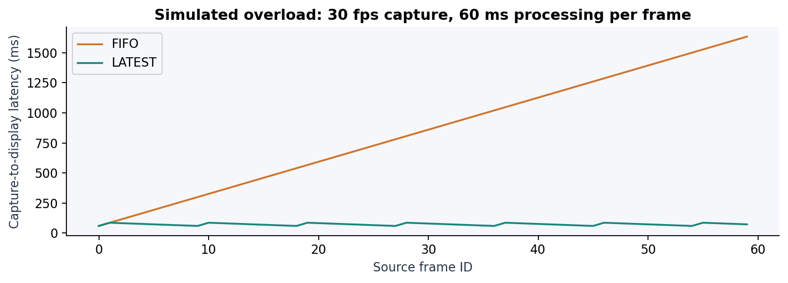

**A fast model can still produce a video stream that is seconds behind the action.**

Dynamic Zoom is a collaborative video super-resolution project. My contribution focused on model execution and displaying upscaled frames alongside the original stream, using the project's Bicubic++ path. The [upstream repository](https://github.com/Dynamic-Zoom/Dynamic-Zoom) contains the shared implementation; this portfolio adds a technical explanation and an independently runnable frame-queue experiment.

## The integration problem

A video pipeline captures a frame, selects a region, prepares tensors, runs inference, and renders output. When capture is faster than processing, a queue can grow even if every component works correctly. The viewer then sees old frames. Throughput, model latency, and capture-to-display latency describe different things.

My work connected model execution with side-by-side output so original and enhanced frames could be compared. A correct comparison also needs frame identity: displaying an enhanced version of frame 100 beside source frame 110 confuses motion differences with restoration quality.

## A runnable experiment: preserve every frame or preserve freshness?

[demo.py](https://github.com/placenciohid/Resume/blob/main/projects/dynamic-zoom/demo.py) simulates sixty arrivals at 30 frames per second and a fixed 60 ms processing time per frame. It compares two policies under the same simulated load:

- **FIFO:** retain and process every frame in order.
- **Latest frame:** retain at most one waiting frame, replacing it when a newer frame arrives.



| Policy | Processed | Dropped | Peak waiting frames | Mean latency | Maximum latency |
| --- | --- | --- | --- | --- | --- |
| FIFO | 60 | 0 | 27 | 846.7 ms | 1633.3 ms |
| LATEST | 34 | 26 | 1 | 73.5 ms | 86.7 ms |

The latest-frame policy substantially reduces latency by dropping 26 frames. It does not make inference faster. For an interactive preview, freshness may matter more than preserving every frame. An offline export usually needs every frame, so FIFO with backpressure—or a slower producer—is the appropriate choice. The right policy follows the product requirement.

The simulation records every processed frame's capture, start, and completion timestamps, plus every dropped frame ID. Tests verify that every input frame is either processed or dropped exactly once, and that the latest-frame waiting queue remains bounded.

## How to benchmark the actual implementation

A useful performance report would state the hardware, model weights, precision, input resolution, region size, output resolution, warm-up, and batch size. Capture, preprocessing, host/device transfer, inference, and display should be measured separately, then checked against end-to-end frame latency. GPU timing also needs synchronization because queued GPU work can return control before it completes.

The earlier project article reports a historical 7–8 ms inference figure. Without a retained hardware fixture and weights, I would describe that as a historical model-stage measurement, rather than convert it into an end-to-end frame-rate claim. The values above are explicitly simulated and reproducible.

## What to inspect upstream

The shared project supports region-of-interest configuration, output frame rate, and Bicubic++ and Swift-SRGAN model choices. Those interfaces are documented in the [upstream README](https://github.com/Dynamic-Zoom/Dynamic-Zoom#readme). Model quality, temporal consistency, and pipeline responsiveness need separate evaluation: a sharper individual frame can still flicker when viewed as a sequence.

## Reproduce

```bash
python projects/dynamic-zoom/demo.py
python -m unittest discover -s tests -v
```

Python 3.10+, no GPU or model download required for the queue experiment. [results.json](https://github.com/placenciohid/Resume/blob/main/projects/dynamic-zoom/results.json) contains the timing and frame-accounting trail. The simulator isolates one integration decision; the original collaborative implementation and third-party models remain attributed to their upstream authors.
