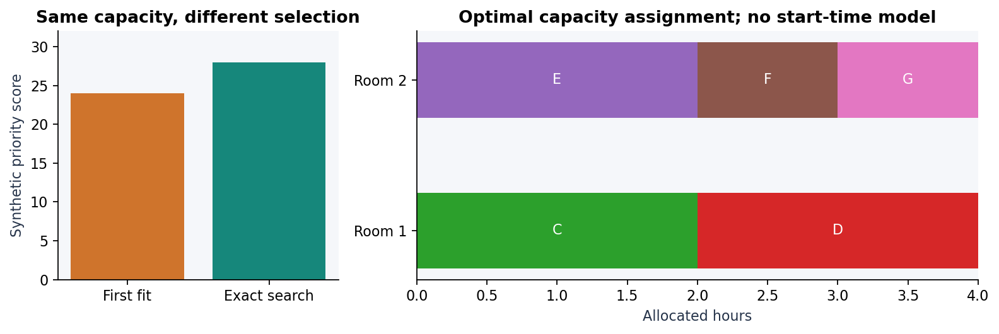

**Full utilization and the best allocation are different objectives.**

This project explores optimization through an operating-room scheduling notebook, Julia constraint-programming puzzles, and a portable capacity-allocation reference. It complements my professional work rebuilding a mining planning model: define the choices, objective, and constraints before asking a solver for an answer.

## A decision that can be inspected

The runnable example assigns eight fictional procedures to two rooms, each with four available hours. Every procedure has a duration and a dimensionless priority score. It may be deferred or assigned to one room. The objective is to maximize total selected priority while respecting each room's capacity.

The first-fit baseline processes the same input order and places each procedure in the first room with capacity. Exact search considers all `3^8 = 6,561` assignments. This small size makes exhaustive enumeration a useful reference against which a larger solver implementation could be checked.

## Model formulation

For procedure `i` and room `r`, let `x[i,r]` be one when the procedure is selected for that room.

```text
maximize   sum(priority[i] * x[i,r])
subject to sum(duration[i] * x[i,r]) <= room_capacity[r]   for each room
           sum(x[i,r]) <= 1                              for each procedure
           x[i,r] in {0,1}
```

No start times, clinical precedence rules, or staff constraints are represented. The graphic below displays capacity allocation; its bar order should not be interpreted as a clinically valid schedule.



## Results: the bottleneck was the selection rule

| Method | Total priority | Allocated capacity |
| --- | ---: | --- |
| First fit | 24 | Both rooms filled |
| Exact allocation | 28 | Both rooms filled |

Both approaches use all eight hours. Exact allocation selects a more valuable combination under the stated objective, demonstrating why utilization alone cannot tell whether an allocation is good. The four-point improvement is a synthetic objective difference; interpreting it as revenue or clinical benefit would require a different, validated objective.

### What to inspect in the implementation

[demo.py](https://github.com/placenciohid/Resume/blob/main/projects/optimization/demo.py) separates `objective`, `solve`, and `first_fit`. The feasibility calculation is shared, keeping the comparison on the same constraints. [results.json](https://github.com/placenciohid/Resume/blob/main/projects/optimization/results.json) records the selected assignments and room loads. Tests check the known optimum and capacity feasibility.

Enumeration is transparent but exponential. A larger case would use mixed-integer programming or a constraint solver. For a solver-backed implementation, I would retain a small instance like this as an independent oracle, then report feasibility, objective bound, optimality gap, and termination condition for larger runs.

## Earlier notebooks: what each contributes

The [Pyomo operating-room notebook](https://github.com/placenciohid/Resume/blob/main/projects/optimization/legacy/Pyomo%20Optimization%20-%20Operating%20Room%20Schedule.ipynb) begins with a historical utilization workbook, filters procedures, and constructs assignment and occupancy constraints. The workbook is not included. Its saved outputs provide an analysis trail, but the portable example is independent of those records.

The [Julia notebook](https://github.com/placenciohid/Resume/blob/main/projects/optimization/legacy/Julia%20Optimization%20-%20Sudoki%20and%20Brain%20Puzzle.ipynb) uses JuMP for Sudoku and a logic puzzle. Puzzle modeling is a useful test of constraint completeness: an omitted constraint can produce a mathematically feasible solution that violates the actual rules.

The transferable skill is translating a practical problem into a model that someone else can challenge. In mining planning, a missing commercial or production constraint can matter much more than a marginally faster solve.

## Reproduce

```bash
python projects/optimization/demo.py
python -m unittest discover -s tests -v
```

Python 3.10+, no external solver required. A useful next step would vary capacities and priorities, check whether the chosen allocation is stable, and discuss the operational cost of deferral. That turns a single optimal answer into a decision conversation.

[Julia article](https://placenciohid.github.io/2023/07/13/Julia_Optimization.html)
