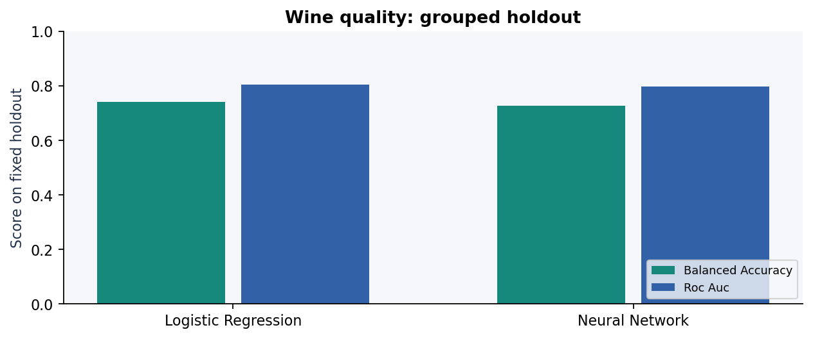

**Use a simpler model to test whether the added complexity is earning its place.**

The original project trained a small dense neural network on the UCI red-wine dataset. The maintained comparison revisits the same binary target—sensory quality of at least six—using a grouped holdout, training-only transformations, and a logistic-regression baseline.

## Protect the evaluation before comparing models

The data contains repeated chemistry profiles. A row-level split can place an identical input in both training and test sets, making generalization look easier. The new [analysis](https://github.com/placenciohid/Resume/blob/main/projects/wine-neural-networks/analyze.py) hashes the eleven chemistry inputs and keeps identical profiles in one partition, even if their sensory scores differ.

The fixed split contains **1,279 training rows and 320 held-out rows**, with zero shared chemistry groups. Standardization is part of each model pipeline. For the neural network, three grouped training folds select L2 regularization from three values; the `(12, 8)` hidden-layer shape is fixed. The test set is evaluated after that selection.

## Result: the baseline is the stronger default here



| Model | Accuracy | Balanced accuracy | ROC AUC |
| --- | --- | --- | --- |
| Logistic Regression | 74.06% | 74.09% | 0.8040 |
| Neural Network | 72.50% | 72.70% | 0.7980 |

The neural network does not improve held-out accuracy, balanced accuracy, or ROC AUC in this run. Its average precision is slightly higher (0.8364 versus 0.8327), showing that a model comparison can depend on the decision metric. That small ranking difference is not enough, by itself, to justify a more complex deployed classifier.

For a fixed 0.5 decision threshold on this sample, logistic regression would be my starting model. The holdout contains only 320 rows, so the difference should be interpreted cautiously. A repeated grouped evaluation or bootstrap at the chemistry-group level would give a clearer view of uncertainty.

## What changed from the original experiment?

The [notebook](https://github.com/placenciohid/Resume/blob/main/projects/wine-neural-networks/legacy/Neural%20Networks%20Application%20-%20Wine%20Quality.ipynb) contains an initial **90.86% training-set accuracy**, grid-search results, and later test diagnostics. The training figure is not a held-out score. Its scaling occurred before the split, and its ROC calculation used thresholded labels rather than continuous scores.

The maintained script addresses those evaluation issues through the pipeline, grouped partitioning, and probability-based ROC AUC and average precision. Its results use a different protocol and should be read on their own terms, rather than compared as a direct percentage-point improvement over the historical notebook.

### Inspect the model-selection boundary

```python
folds = StratifiedGroupKFold(n_splits=3, shuffle=True, random_state=42)
search = GridSearchCV(network,
    {'mlpclassifier__alpha': [.1, 1., 10.]},
    scoring='balanced_accuracy', cv=folds, n_jobs=1, refit=True)
search.fit(x.iloc[train], y.iloc[train], groups=groups.iloc[train])
```

The final network stops after 59 training iterations under the configured training-loss convergence rule. The selected regularization, fold score, exact input columns, class balance, and confusion matrices are retained in [analysis-results.json](https://github.com/placenciohid/Resume/blob/main/projects/wine-neural-networks/analysis-results.json).

## Reproduce

```bash
python -m pip install -r requirements-analysis.txt
python projects/wine-neural-networks/analyze.py
```

The [attributed UCI dataset](https://github.com/placenciohid/Resume/blob/main/data/public/README.md) is included. A single grouped holdout does not establish superiority across populations, and the quality threshold is a chosen modeling target. The useful outcome is a comparison that can support a decision—including the decision to keep a simpler model.

[Chemistry-only clustering](https://github.com/placenciohid/Resume/tree/main/projects/wine-clustering) · [Train-only preprocessing](https://scikit-learn.org/stable/common_pitfalls.html)
