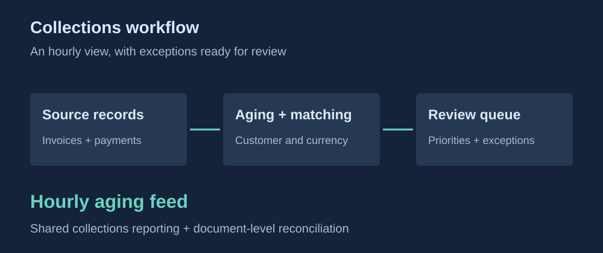



## Keeping collections information current

Collectors need to see overdue balances, unapplied payments, customer risk, and follow-up priorities together. Repeated manual SAP extracts make that picture harder to keep current and consistent.

In Commercial Services, I delivered Atlantic Aluminium’s collections reporting and an **hourly accounts-receivable aging feed**. The collections dashboard brings performance, customer-group trends, and collector assignments into a shared reporting workflow.

## Making reconciliation easier to review

I also delivered reconciliation views to help users inspect invoice matches, payment differences, and clearance exceptions. A remittance can contain multiple invoice lines, so the review needs to distinguish a fully matched document from a document with unresolved items.

The practical focus was to make the next action visible: which customer or invoice needs attention, what differs, and what remains to be cleared. The hourly feed was designed to replace recurring manual report transactions; a refresh schedule alone is not used here as proof of measured labor savings or recovered cash.

### Controls behind the view

The public example shows the calculation decisions that matter: currency separation, explicit reporting dates, duplicate-reference detection, and document-level payment totals. It counts each payment once rather than repeating its amount across every invoice line.

## Explore the implementation

The GitHub companion contains fictional invoices and remittances, aging calculations, document matching, exception outputs, and focused tests. It demonstrates the logic in a portable implementation rather than exposing internal Power BI models or customer records.

Technical walkthrough Code, sample data, results & reproduction



<a href="/all_posts.html">Explore all projects →</a><a href="mailto:darioplacenciohidalgo@gmail.com">Discuss my work →</a>

