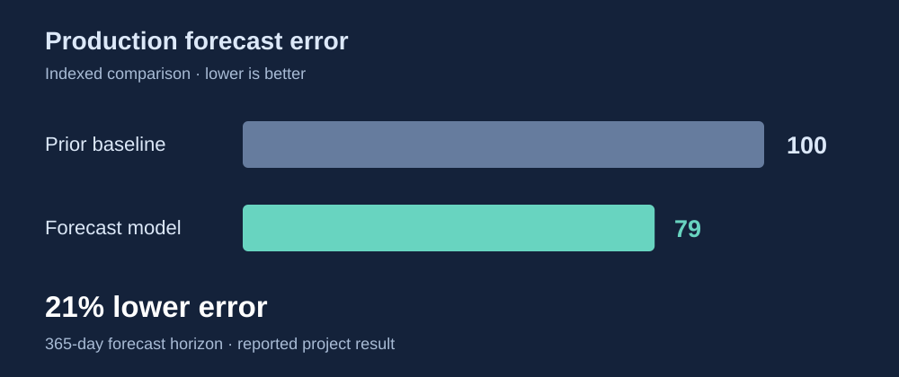



## Production forecasting for a year-ahead view

At Rio Tinto’s Borates Digital team, I developed a 365-day production forecasting pipeline using a Temporal Fusion Transformer. The work covered data preparation, modeling, and evaluation, with quantile estimates to communicate uncertainty around the forecast.

The resulting forecast reduced error by **21% against the prior baseline**. The comparison below indexes the baseline at 100 and the model at 79; it shows the reported relative improvement without exposing the underlying production series.

### Why the method mattered

A year-ahead forecast must cover both the expected outcome and its uncertainty. Quantile forecasts give planners a range to consider, while a baseline comparison tests whether the added model complexity improves the forecast. My contribution connected the data pipeline, model, and evaluation.

## Planning optimization

I rebuilt the annual EBITDA optimization model from a legacy Excel workbook as a Python linear program in Palantir Foundry. This made the model’s objective and constraints inspectable in code and supported repeatable planning analysis. The work identified **$746K in confirmed savings**.

## Cash-receivables forecasting

In Commercial Services, I developed a seven-day cash-receivables forecasting proof of concept and evaluated it in a four-week trial. The trial achieved **77% weekly accuracy** and provided a basis for the team to continue the work. The trial is complete; its findings supported further evaluation by the team.

## Explore the implementation

The GitHub companion demonstrates rolling-origin evaluation with a seasonal baseline, held-out errors, and train-only fitting. It uses generated daily production data, so it can be run independently of the professional systems above.

Technical walkthrough Code, sample data, results & reproduction



<a href="/all_posts.html">Explore all projects →</a><a href="mailto:darioplacenciohidalgo@gmail.com">Discuss my work →</a>

