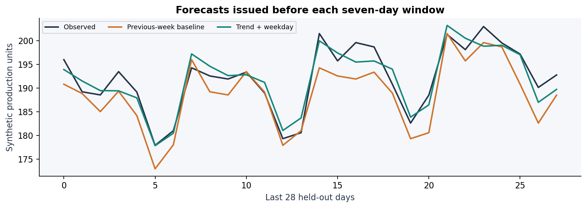



**Turn a view of future production into something a planning team can use—and evaluate it against the information available at the time.**

At Rio Tinto’s Borates Digital team, I developed a 365-day production forecasting pipeline using a Temporal Fusion Transformer and rebuilt an annual planning optimization model in Python. In Commercial Services, I later developed a seven-day cash-receivables forecasting proof of concept. These are related decision problems with different horizons, inputs, and definitions of success.

## Professional work: the decision behind each model

| Work | My contribution | Reported result |
| --- | --- | --- |
| Year-ahead production forecasting | Data preparation, a Temporal Fusion Transformer pipeline, and evaluation against the prior baseline | 21% lower forecast error over a 365-day forecasting horizon |
| Annual planning optimization | Rebuilt a legacy Excel EBITDA optimization model as a Python linear program in Palantir Foundry | $746K in confirmed savings identified |
| Near-term cash forecasting | Developed a seven-day receivables forecasting proof of concept and evaluated it in a four-week trial | Completed trial supplied a basis for the team to advance the work |

The planning model also surfaced a $7.3M over-commitment diagnostic. That is a planning exposure identified, separate from the $746K savings figure. Neither number is an output of the public example below.

### Why these are different problems

A production forecast estimates what may happen. A planning optimizer chooses among feasible actions given an objective and constraints. A cash forecast adds another complication: an invoice's due date and its actual payment date can differ. Treating all three as a single accuracy exercise hides the business decision.

For the production work, a multi-horizon model was relevant because the planning question extended across a year. The [Temporal Fusion Transformer paper](https://arxiv.org/abs/1912.09363) distinguishes historical observations, known future inputs, and static attributes. That distinction is useful before training: a feature should only be available at a future horizon if the business would actually know it when the forecast is issued.

For optimization, the core work was making the objective and constraints explicit in code. A financially attractive solution is useful only when it respects the operating constraints. The public scheduling project [develops that idea separately](https://github.com/placenciohid/Resume/tree/main/projects/optimization).

## Public implementation: an inspectable forecasting evaluation

The companion focuses on the evaluation contract. It generates 180 daily production observations with a trend, weekday pattern, and seeded noise, then compares two methods on the same future windows:

- **Seasonal naive:** repeat the last observed week.
- **Trend plus weekday:** fit a linear trend and seven weekday effects using past observations.

The first training window contains 84 days. Thirteen successive seven-day windows provide **91 held-out predictions**; the final five observations do not form another complete window. Each origin refits the model using only preceding rows. This is a small independent reference, using synthetic production units, rather than a reproduction of the internal Transformer model.



## Results and what they establish

| Method | Mean absolute error | WAPE |
| --- | ---: | ---: |
| Previous-week baseline | 3.8145 | 2.14% |
| Trend plus weekday | 2.1790 | 1.22% |

The generator contains the trend and weekday structure that the comparison model fits. Its lower error shows that the implementation recovers that structure under this controlled setup. It does not establish a transferable industrial improvement. The professional 21% result above comes from the separate production project.

**The more useful evidence is the evaluation trail.** [results.json](https://github.com/placenciohid/Resume/blob/main/projects/forecasting/results.json) retains every prediction's origin, target date, lead time, observed value, and both forecasts. That makes it possible to audit a score, compare errors by horizon, or investigate a bad week instead of accepting a single aggregate number.

### Code worth inspecting

```python
history, future = rows[:origin], rows[origin:origin+horizon]
model = fit(history)
expected = predict(model, [r['date'] for r in future])
baseline = [history[-7+i % 7]['value'] for i in range(horizon)]
```

In [demo.py](https://github.com/placenciohid/Resume/blob/main/projects/forecasting/demo.py), `backtest` enforces complete, ordered daily observations; `metrics` rejects mismatched prediction lengths. The residual range shown in the next-week output is illustrative, estimated from training residuals. It would need out-of-sample coverage checks before being described as a calibrated prediction interval.

<details class="technical-detail" markdown="1">
<summary>Run and inspect the implementation <span>Source, results & reproduction</span></summary>

## Reproduce and review

```bash
python projects/forecasting/demo.py
python -m unittest discover -s tests -v
```

Python 3.10+ and the standard library are sufficient. [sample.csv](https://github.com/placenciohid/Resume/blob/main/projects/forecasting/sample.csv) is a human-readable copy of the generated history. The checks cover temporal ordering, future-value independence, multiweek baseline lengths, missing dates, zero-volume metrics, and ordered forecast ranges.

For an operational rollout, I would examine forecast bias and error by horizon, preserve the assumptions known at each issue date, and compare performance during shutdowns or process changes. A model that performs well in a stable period may be the wrong choice when the operating regime changes. That is why the evaluation design belongs in the deliverable alongside the model.

[Forecasting principles: rolling-origin evaluation](https://otexts.com/fpp3/toolbox.html#time-series-cross-validation)


</details>
