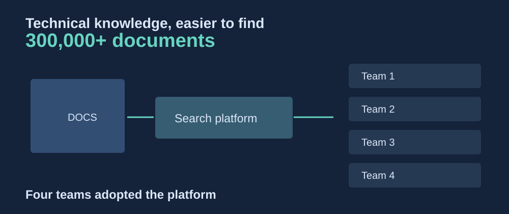



## The operational problem

Technical information was spread across a large collection of documents. Finding a useful answer could require locating and reading several files before the operational work could continue. Search needed to handle both document images and the terminology people used to ask questions.

## What I delivered

At Rio Tinto’s Borates Digital team, I engineered a document-search pipeline covering **more than 300,000 documents**. It combined text extraction using vision-language models, keyword and semantic retrieval, and reranking. **Four teams adopted the platform.**

### The engineering decisions

The pipeline had to make image-based content searchable as well as documents with embedded text. Retrieval combined exact vocabulary with semantic similarity; reranking then selected the most relevant passages. Preserving the document identity through extraction and indexing was essential so users could trace a result back to its source.

My work spanned the data pipeline and search workflow. The result was a shared way to find relevant technical material across the collection. Adoption across four teams demonstrates use; no unmeasured time-saving figure is attached to it here.

## Explore the implementation

The public companion makes the retrieval stages visible: chunking, two indexes, rank fusion, reranking, and source excerpts. Its fictional corpus and lexical vector index let anyone run and inspect the example without access to the employer system.

Technical walkthrough Code, sample data, results & reproduction



<a href="/all_posts.html">Explore all projects →</a><a href="mailto:darioplacenciohidalgo@gmail.com">Discuss my work →</a>

